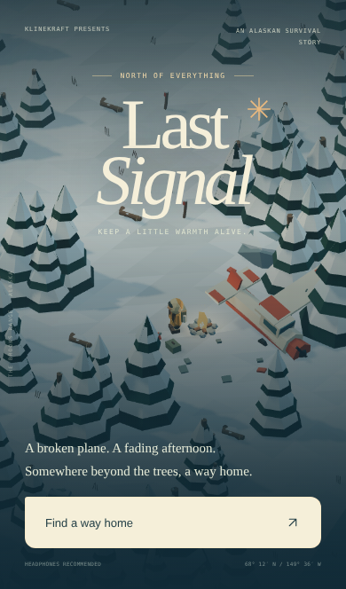
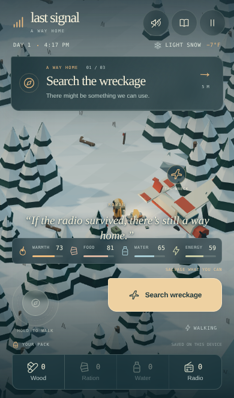

# Last Signal

**Keep a little warmth alive.**

An iPhone-first, low-poly survival story set in the Brooks Range, Alaska. Rowan's plane is down. Salvage what remains, tend the fire, follow the red trail stakes and send one signal home.

<p>
  
  
</p>

## Play locally

```sh
python3 -m http.server 8000
```

Open http://localhost:8000. The game is a static website: no build, account, backend or game API. Deploy the repository with `index.html`, `styles.css`, `game.js`, `world.js`, `audio.js`, `favicon.svg`, and the complete `vendor/` directory. ES modules require HTTP serving rather than opening the HTML as a file.

### Controls

| Action        | iPhone / touch                                        | Desktop                           |
| ------------- | ----------------------------------------------------- | --------------------------------- |
| Walk          | Hold and drag the left thumb pad, or hold the terrain | WASD / arrows or hold the terrain |
| Run           | Tap the lightning / walking control                   | Hold Shift                        |
| Interact      | Tap the contextual gold button                        | E or the button                   |
| Eat / drink   | Tap a supply in your pack                             | 1 / 2 or the supply buttons       |
| Pause         | Top-right pause button                                | Escape or pause button            |
| Field journal | Book button                                           | Book button                       |
| Ambient sound | Speaker button; off until enabled                     | Speaker button                    |

Search the aircraft for radio parts, food and water. Gather dry branches. Each piece of wood fuels the crash-site fire for 45 seconds; stay nearby to recover warmth. Bring the radio parts and **two wood** to the northwest ridge-top beacon. Warmth, food or water reaching zero ends the expedition.

Your expedition saves on interactions, every five simulation seconds and when pausing. Choose **Continue your story** to resume. Saves stay on this device and need browser storage. The game pauses automatically when you leave the page. Begin a new story from the pause screen to start over.

## Art and engineering

See [DESIGN.md](DESIGN.md) for the visual direction, Three.js research, iPhone interaction choices, rendering budgets and validation limits.

- **Three.js r187**, locally bundled ES modules; WebGL 2 required.
- Original procedural artwork: layered spruce, faceted snow, frozen creek, red bush plane, bundled-up Rowan and a repaired-by-hand beacon.
- ACES tone mapping, sRGB output, a single sun shadow map and instanced scenery.
- Procedural ambient audio, optional and gesture-activated. No audio or font downloads.
- Safe-area layout, portrait and landscape controls, reduced-motion support, keyboard access and live status messages.

## Development checks

```sh
npm ci
npm run check
npm test
```

Python 3 serves the test site. Tests use `/usr/bin/chromium` by default; set `CHROMIUM_PATH` for a different executable. To check WebKit on a machine with its system dependencies installed:

```sh
npx playwright install --with-deps webkit
PLAYWRIGHT_BROWSER=webkit npm test
```

Browser scenarios cover the rescue loop, consumables, fire recovery, save/continue, pause, failure and restart, mobile movement, touch thumb controls, running, journal and sound controls, small portrait and landscape bounds. Distant mission stages use seeded saves; these checks do not measure physical iPhone performance.

`three` is pinned in `package.json`. The minified ES-module bundle is checked into `vendor/` so the deployed game does not contact a CDN. Regenerate it from the pinned package with `npm run vendor`. Its MIT license is included in `vendor/THREE-LICENSE.txt`.
